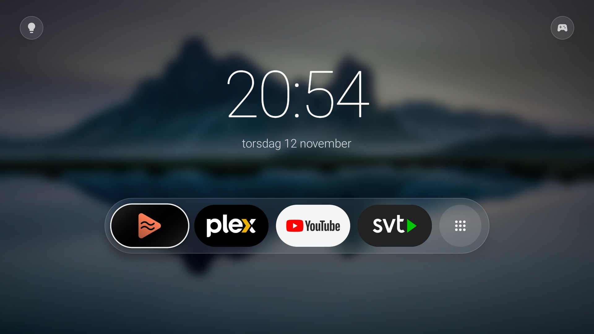

# TV launcher

A clean, ad-free home screen for my Philips Android TV (Android 11). It replaces Google's
stock launcher and its sponsored rows.



## What it does

- **App dock**: my apps in one glass bar. Long-press OK to move a tile. The last button opens
  all apps.
- **HDMI inputs** (top right): the TV's inputs and HDMI-CEC devices, such as the PlayStation 5.
  A green dot means the device is on. Pick one to switch to it.
- **Philips Hue** (top left): scenes, favourites, brightness and an all-lights switch, through
  the local Hue bridge.
- **Wallpapers per item**: an input or app can have its own images. When it has focus, the
  background fades to a random one of them.

It's a plain `android.app.Activity` app without AndroidX, small enough for the TV's slow CPU.

## Build and run

You need JDK 17 and the Android SDK (platform 35). The TV must be reachable over adb.

```sh
./tv.sh build      # build the debug APK into build/apk/
./tv.sh deploy     # build, install on the TV and open it
./tv.sh home on    # make it the default home screen (`home off` undoes it)
./tv.sh            # all commands
```

`./tv.sh ci-build` builds on GitHub Actions instead and downloads the APK.

## Setup on the TV

```sh
./tv.sh hue-key                                    # copy the Hue bridge key into the app
./tv.sh wallpaper add "PlayStation 5" art.jpg      # wallpapers for an input or app
./tv.sh wallpaper                                  # list them and the space left
./debloat.sh status                                # remove the TV's bloat apps (apply / undo)
```

## Design

The HTML mockups in `design/` show each feature's variants on a 1920×1080 canvas. Open one in a
browser and use the arrow keys.

## Credits

The default wallpaper is a photo by [Colin Watts](https://unsplash.com/@colinwatts) on
[Unsplash](https://unsplash.com/photos/T5g1bLqJego), cropped to 16:9.
